<p align="center">
  
</p>

<p align="center">
  <a href="https://github.com/Kimi-clouds">
    
  </a>
</p>

<p align="center">
  
  
  
</p>

<p align="center">
  
  
  
</p>

---

## ✨ About Me


📌 **Azure Cloud Security Engineer**<br>
📍 Based in Pakistan<br>
🏅 Microsoft Certified: **AZ-900** and **SC-900**<br>
📚 Currently preparing for **AZ-104**<br>
🎯 Goal: remote freelance work in cloud security<br>
<br>
🔥 I'm building my career in cloud security from scratch, focusing on Azure, identity and access, Zero Trust, and hands-on practice through labs and TryHackMe.

<br clear="right"/>

---

## 🏅 Certifications


---

## 📚 Learning Journey

```js
const kimi = {
  focus: ["Cloud Security", "Azure", "Ethical Hacking"],
  current: "AZ-104: Azure Administrator",
  completed: [
    "✅ AZ-900: Azure Fundamentals",
    "✅ SC-900: Security, Compliance & Identity Fundamentals",
    "✅ Course 1: Cloud & Cybersecurity",
    "✅ TryHackMe: Offensive Security",
    "✅ TryHackMe: Defensive Security",
    "✅ TryHackMe: What is Networking?"
  ]
};
```

---

## 🛠️ Skills Building

| Skill | Status |
|-------|--------|
| ☁️ Microsoft Azure | 🔄 In progress |
| 🔒 Cybersecurity & Zero Trust | 🔄 In progress |
| 🐧 Linux Basics | 🔄 In progress |
| 🌐 Networking | 🔄 In progress |
| 🏅 AZ-900 | ✅ Completed |
| 🏅 SC-900 | ✅ Completed |
| 🎯 AZ-104 | 🔄 In progress |
| 🎯 AZ-500 | ⏳ Up next |

---

## 🧰 Tech Stack

<p align="center">
  
</p>

---

## 📊 GitHub Stats

<p align="center">
  
</p>

<p align="center">
  
</p>

<p align="center">
  
</p>

---

## 📫 Connect with Me

<p align="center"> <a href="https://www.linkedin.com/in/hinaa-saleem-393b50247">  </a> <a href="https://discord.com/users/1385940552868036680">  </a> </p>

---

## 🐾 Contribution Graph

<p align="center">
  
</p>
